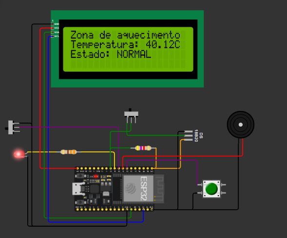

# Projeto Loading — Monitoramento e controle de temperatura

Protótipo desenvolvido para o desafio de Sistemas Embarcados do processo seletivo da Loading Desenvolvimento Jr. 2026.2, utilizando ESP32 e simulação no Wokwi.

## Ideia do projeto

A ideia é representar o monitoramento de uma zona de aquecimento de uma máquina injetora, inspirado em situações do ambiente industrial. O sistema acompanha a temperatura, sinaliza condições fora dos limites definidos e simula o comando de aquecimento.

Além do funcionamento normal, o projeto permite demonstrar dois problemas: a perda de comunicação com o sensor e um relé que fica travado na posição ligada. Nessa segunda situação, mandar desligar o aquecimento não seria suficiente. Por isso, foi representado um corte independente, acionado após uma falha prolongada do sensor.

O rearme manual representa a confirmação de uma checagem antes da retomada. Após o bloqueio, apenas reconectar o sensor não libera o aquecimento: é necessário corrigir as condições de falha e acionar novamente o botão.

É uma simulação didática de uma única zona. As temperaturas foram escolhidas para facilitar os testes e não representam parâmetros de operação de uma injetora real. O LED representa o aquecimento; ele não aquece o sensor virtual. A temperatura do DS18B20 é ajustada manualmente no Wokwi.

## Tecnologias e dependências

- **Linguagem:** C++, utilizando o ambiente Arduino para ESP32.
- **Plataforma:** ESP32 DevKitC V4.
- **Simulador:** Wokwi.
- **Versionamento:** Git e GitHub.
- **Comunicação:** OneWire para o sensor, I2C para o LCD e Serial para diagnóstico.

| Biblioteca | Uso |
|---|---|
| `OneWire` | Comunicação com o DS18B20 |
| `DallasTemperature` | Solicitação e leitura da temperatura |
| `LiquidCrystal I2C` | Controle do LCD, pelo cabeçalho `LiquidCrystal_I2C.h` |
| `Wire` | Comunicação I2C; incluída no suporte do ESP32 |
| `Preferences` | Armazenamento do estado de bloqueio; incluída no suporte do ESP32 |
| `stdio.h` | Formatação do texto da temperatura com `snprintf` |

As três bibliotecas externas estão declaradas no arquivo `libraries.txt`. Não é necessário adicionar `Wire`, `Preferences` ou `stdio.h` nesse arquivo.

## Componentes e conexões

| Componente | Ligação / função |
|---|---|
| ESP32 | Executa o monitoramento e o controle |
| DS18B20 | Dados no GPIO27, alimentação em 3,3 V e GND |
| Resistor de 4,7 kΩ | Pull-up entre GPIO27 e 3,3 V |
| LCD I2C 20×4 | Endereço `0x27`; SDA no GPIO21, SCL no GPIO22, alimentação em 5 V e GND no simulador |
| LED vermelho e resistor de 330 Ω | GPIO26; representam o aquecimento |
| Chave `sw1` | GPIO25 e GND; simula o relé travado |
| Chave `sw2` | Interrompe a conexão de dados entre o sensor e o GPIO27 |
| Botão verde `btn1` | GPIO32 e GND; realiza o rearme |
| Buzzer | Positivo no GPIO33 e negativo no GND |

O GPIO25 e o GPIO32 usam `INPUT_PULLUP`: a entrada em `LOW` indica, respectivamente, relé travado e botão pressionado. O circuito completo está em `diagram.json`.

## Funcionamento

### Leitura e estados

A cada ciclo, o programa solicita uma medição ao DS18B20 e apresenta a temperatura e o estado no LCD. O Monitor Serial, configurado em **115200 baud**, mostra também comando, relé travado, aquecimento, bloqueio, botão, falha do sensor e disponibilidade da memória.

| Condição da leitura | Mensagem no LCD | Alarme sonoro |
|---|---|---|
| Temperatura abaixo de 30 °C | `ALERTA FRIO` | 500 Hz |
| Temperatura de 30 °C a 60 °C, incluindo os limites | `NORMAL` | Sem som |
| Temperatura acima de 60 °C | `ALERTA CALOR` | 1.000 Hz |
| Sensor sem leitura válida | `FALHA SENSOR`, com `--` no lugar da temperatura | 2.000 Hz |

A falha do sensor tem prioridade sobre os alertas de temperatura. O retorno de desconexão não é interpretado como uma temperatura baixa.

O estado `NORMAL` indica ausência de alarme de temperatura; não significa necessariamente que o aquecimento esteja ligado ou que o sistema esteja liberado. O bloqueio é mostrado separadamente na última linha do LCD.

### Controle do aquecimento

O controle utiliza histerese:

- Em **48 °C ou menos**, solicita aquecimento.
- Em **50 °C ou mais**, desliga o comando de aquecimento.
- Entre **48 °C e 50 °C**, mantém o comando anterior.

Essas regras são aplicadas quando o sistema está liberado e o sensor está funcionando. O bloqueio ou a leitura inválida têm prioridade e desligam o comando.

A faixa de controle de 48–50 °C é diferente dos limites de alarme de 30 e 60 °C. A sobretemperatura gera alerta, mas não cria um bloqueio manual nesta versão.

### Falha do sensor e corte independente

Ao detectar a perda de leitura, o programa desliga o comando de aquecimento, sinaliza a falha e inicia a contagem do tempo.

Com o relé normal, o LED apaga. Com o relé travado, o LED permanece aceso apesar do comando desligado, até que a falha atinja o critério de bloqueio.

Após **10 segundos ou mais de falha contínua detectada**, o sistema bloqueia e apaga o LED mesmo com a simulação de relé travado ativa. O LCD mostra `Bloqueado: REARME`.

Se o sensor voltar antes do bloqueio, o controle é retomado automaticamente. Depois de bloquear, a recuperação do sensor não remove o bloqueio. O som acompanha a condição atual da leitura e pode parar enquanto o pedido de rearme continua aparecendo.

O corte independente é representado pela lógica do programa. Não há um contator ou segundo dispositivo de corte físico nesta montagem; o código não demonstra a abertura de um relé real que esteja travado.

### Rearme manual e memória

O rearme exige:

1. Sistema bloqueado.
2. Sensor com leitura válida.
3. Simulação de relé travado desativada.
4. Memória disponível.
5. Botão observado solto nessas condições e, depois, pressionado.

Manter o botão segurado enquanto o sensor volta ou o relé é destravado não libera o sistema. Não existe temperatura mínima para rearmar.

O programa usa `Preferences` para salvar o bloqueio e a liberação. O rearme só é aceito após a confirmação da gravação. Sem registro salvo, a inicialização assume o estado bloqueado e exige um primeiro rearme. Se a abertura da memória ou a gravação falhar, o programa informa o problema no Serial e mantém o bloqueio naquela execução.

**Não foram testadas situações de reinício do ESP32 ou desligamento da energia, nem a recuperação do estado salvo nessas situações.** Para esta demonstração, foram priorizados os testes feitos pelos controles do circuito no Wokwi. Optou-se por não adicionar comandos de reinício ao programa apenas para realizar esses testes. Portanto, o uso de `Preferences` está implementado, mas seu comportamento após reinício ou interrupção da energia não foi validado.

### Intervalo de aquisição

Foi adotada uma pausa de **800 ms ao final de cada ciclo**, somada ao tempo da conversão do sensor, comunicação e atualização das saídas. Portanto, o intervalo total entre leituras não é fixo nem corresponde somente ao `delay(800)`.

Nos registros obtidos durante os testes, os ciclos ficaram próximos de **1,7 s com leitura válida** e de **0,92 s durante a desconexão**. São valores aproximados, observados na simulação. A diferença entre duas mensagens consecutivas de início do ciclo permite acompanhar esse tempo.

A contagem da falha começa na primeira leitura inválida. O corte ocorre no primeiro ciclo que identifica pelo menos 10.000 ms de falha, podendo ultrapassar ligeiramente esse valor.

## Como executar no Wokwi

> **Cuidado ao representar falhas ou alertas de estado frio e calor, o áudio pode ser alto.** Diminua o volume antes de iniciar a simulação.

A simulação funciona pelo navegador e pode ser acessada de duas formas:

### Opção 1 — Acessar o projeto pelo link

1. Abra o arquivo [wokwi-project.txt](wokwi-project.txt) deste repositório.
2. Acesse o endereço do Wokwi indicado nele. Você também pode abrir diretamente o [projeto no Wokwi](https://wokwi.com/projects/480599036117238785).
3. Siga as instruções de **“Iniciar e fazer o primeiro rearme”**, abaixo.

Nessa opção, o circuito e o código já estão no projeto. Não é necessário copiar os arquivos.

### Opção 2 — Criar uma cópia usando os arquivos do repositório

1. Crie um projeto ESP32 no Wokwi.
2. Abra [sketch.ino](sketch.ino) neste repositório, copie todo o conteúdo e substitua o conteúdo do arquivo `sketch.ino` no seu projeto do Wokwi.
3. Faça o mesmo com [diagram.json](diagram.json). Esse arquivo contém os componentes e as conexões do circuito.
4. Copie também todo o conteúdo de [libraries.txt](libraries.txt) para um arquivo de mesmo nome no projeto do Wokwi. Ele indica as bibliotecas externas necessárias.
5. Confira se os três arquivos estão com os mesmos nomes e siga as instruções de **“Iniciar e fazer o primeiro rearme”**, abaixo.

Os três arquivos necessários para executar a cópia são `sketch.ino`, `diagram.json` e `libraries.txt`. O README e a imagem servem como documentação e não precisam ser copiados para o simulador.

### Identifique os controles

| Onde está na imagem | Componente | Para que serve |
|---|---|---|
| Chave na lateral esquerda, acima do LED | **Relé travado (`sw1`)** | Simula um relé preso na posição ligada. Não é um relé físico. |
| Chave no centro, abaixo do LCD e acima do ESP32 | **Falha do sensor (`sw2`)** | Conecta ou interrompe a comunicação com o sensor. |
| Botão verde à direita do ESP32 | **Rearme (`btn1`)** | Libera o sistema após o bloqueio, quando as condições permitem. |
| Componente preto pequeno, acima e à direita do ESP32 | **Sensor DS18B20** | Clique nele para alterar a temperatura simulada. |
| LED vermelho à esquerda | **Aquecimento** | Aceso representa aquecimento ligado; apagado representa aquecimento desligado. |
| Tela verde na parte superior | **LCD** | Mostra a temperatura, o estado e o pedido de rearme. |
| Componente preto redondo à direita | **Buzzer** | Emite os alarmes sonoros. |
| Placa na parte inferior | **ESP32** | Executa o programa. |

### Iniciar e fazer o primeiro rearme

1. Clique no botão de iniciar a simulação e aguarde aparecerem as informações no LCD. **Não segure o botão verde ao iniciar.**
2. Clique no **sensor DS18B20** e ajuste a temperatura para **40 °C**. O LCD deve mostrar essa temperatura. Se aparecer `--` e `FALHA SENSOR`, mude a **chave do centro** e aguarde a leitura voltar.
3. Confira no Monitor Serial se aparece **`Rele travado: 0`**. Se aparecer `1`, mude a **chave da esquerda** e aguarde aparecer `0`.
4. Se o LCD mostrar **`Bloqueado: REARME`**, deixe o **botão verde solto por 3 segundos**. Depois, pressione e segure por **2 segundos** e solte.
5. Confira o resultado: a mensagem de rearme deve desaparecer e, em **40 °C**, o **LED deve acender**.

Sem um estado salvo na memória, o sistema começa bloqueado. Isso é esperado: a temperatura já aparece no LCD, mas o aquecimento só é liberado pelo primeiro rearme. Se não houver pedido de rearme, siga para os testes.

### Rearmar depois de um teste de falha

1. Reconecte o sensor pela **chave do centro** e aguarde a temperatura reaparecer no LCD.
2. Desative o relé travado pela **chave da esquerda**. Confira `Rele travado: 0` no Serial.
3. Deixe o **botão verde solto por 3 segundos**.
4. Pressione o botão por **2 segundos** e solte. O pedido de rearme deve desaparecer.

É necessário soltar o botão depois de corrigir as falhas e só então pressioná-lo novamente. Mantê-lo pressionado durante a recuperação não libera o sistema. Os tempos sugeridos permitem que o programa reconheça o botão; um toque muito rápido pode passar despercebido.

## Validação e roteiro de demonstração

Foram realizados testes manuais no Wokwi durante o desenvolvimento, acompanhando o LCD, o LED, o buzzer e as mensagens do Serial. Foram verificados os alertas, o bloqueio por falha prolongada, o corte com relé travado e as condições de rearme. Não foi feito teste em hardware físico.

A tabela apresenta um roteiro para repetir a demonstração. Comece os testes de funcionamento normal com sensor conectado, relé destravado e sistema liberado.

| Teste | Procedimento | Resultado esperado |
|---|---|---|
| Temperatura baixa | Ajustar para 25 °C | `ALERTA FRIO`, som de 500 Hz e comando de aquecimento ligado |
| Estado normal | Ajustar para 40 °C | `NORMAL`, sem som e comando de aquecimento ligado |
| Temperatura alta e retorno | Ajustar para 65 °C e depois 40 °C | Alerta e som de 1.000 Hz em 65 °C; retorno a `NORMAL` e silêncio em 40 °C |
| Histerese | Ajustar na sequência 48 → 49 → 50 → 49 → 48 °C | Comando ligado → ligado → desligado → desligado → ligado |
| Falha curta | Desconectar por alguns segundos e reconectar antes do bloqueio | Falha sinalizada; retorno automático após leitura válida |
| Falha prolongada | Desconectar e aguardar pelo menos 10 s de falha detectada | Bloqueio e pedido de rearme |
| Relé travado e falha | Ativar `sw1`, desconectar o sensor e aguardar o bloqueio | Comando desligado; LED permanece aceso antes do bloqueio e apaga depois |
| Recuperação sem rearme | Reconectar o sensor após o bloqueio, sem pressionar o botão | Leitura retorna, mas LED permanece apagado |
| Rearme impedido | Tentar rearmar com sensor desconectado ou relé travado | Sistema permanece bloqueado |
| Botão mantido pressionado | Segurar o rearme durante a recuperação do sensor e o destravamento do relé | Sistema continua bloqueado até observar o botão solto e um novo pressionamento |
| Rearme válido | Corrigir as falhas, deixar o botão solto por 3 s e pressionar por 2 s | Bloqueio removido; em 40 °C, aquecimento volta a ligar |

Os testes descritos foram realizados durante a execução da simulação. Não foram testados reinício do ESP32, desligamento da energia ou recuperação da memória após esses eventos. O primeiro rearme não comprova essa recuperação, pois o sistema também começa bloqueado quando não há estado salvo.

## Relação com os requisitos do desafio

| Requisito | Implementação |
|---|---|
| RF01 — Aquisição periódica | Leitura do DS18B20 a cada ciclo, com intervalo documentado acima |
| RF02 — Exibição | Temperatura e estados no LCD e informações de diagnóstico no Serial |
| RF03 — Limite | Alerta para temperatura acima de 60 °C |
| RF04 — Estados | Estados normal e alerta, com retorno automático conforme a leitura |
| RF05 — Leitura inválida | Detecção de desconexão, indicação de falha e alarme próprio |
| RF06 — Demonstração | Cenários reproduzíveis no Wokwi abaixo e acima do limite e com leitura inválida |

Como melhorias adicionais, foram implementados alerta de temperatura baixa, controle por histerese, alarmes distintos, simulação de relé travado, bloqueio temporizado, rearme condicionado e gravação do bloqueio em memória.

## Arquivos do projeto

| Arquivo | Conteúdo |
|---|---|
| `sketch.ino` | Código do monitoramento, controle, interface e proteções simuladas |
| `diagram.json` | Componentes e conexões do circuito no Wokwi |
| `libraries.txt` | Bibliotecas externas utilizadas |
| `wokwi-project.txt` | Referência ao projeto no simulador |
| `README.md` | Descrição, execução, funcionamento e validação |
| `circuito-wokwi.png` | Imagem do circuito usada no guia de utilização |

## Limitações da versão

- A temperatura é ajustada manualmente no sensor virtual; não há modelo automático de aquecimento e resfriamento.
- O LED e a lógica de corte representam o processo de forma didática. Não houve validação para uso em uma máquina real.
- Não foram testadas situações de reinício do ESP32 ou desligamento da energia, incluindo a recuperação do estado salvo e o comportamento da contagem de falha após esses eventos.
- O código salva o estado de bloqueio, mas não o tempo já acumulado de uma falha. O efeito de um reinício nessa contagem não foi testado.
- A leitura dos botões ocorre uma vez por ciclo, podendo perder acionamentos rápidos.
- Acima de 60 °C há alerta, mas não bloqueio por sobretemperatura. Com relé travado e sensor válido, o aquecimento simulado pode permanecer ligado nessa condição.

## Uso de inteligência artificial

Foi utilizado o ChatGPT como apoio para compreender componentes e bibliotecas, revisar trechos de código, investigar erros, planejar testes e organizar os comentários e esta documentação.

A responsabilidade pela compreensão das decisões e pela validação do projeto permanece com o autor. Os testes pendentes estão indicados neste README.
